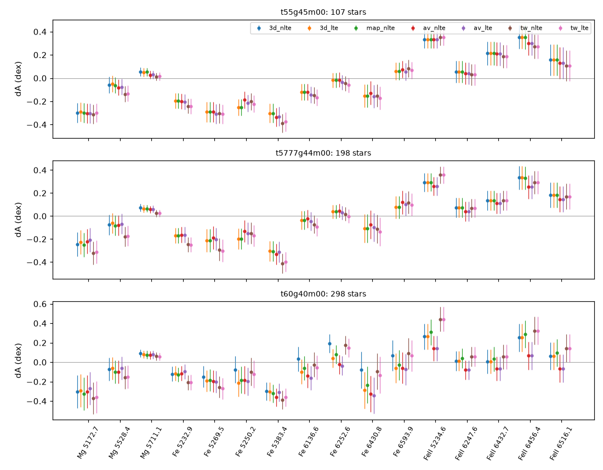
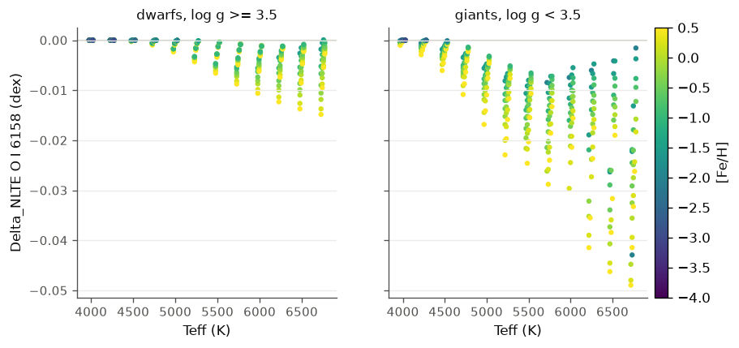

# Alpha campaign, phase 6: 3D results, crop level, 4MOST comparison

Date: Mon 2026-10-05 22:30 onwards (CEST). Branch `agent/alpha-phase6` from 4890f9fde.
`$C = /mnt/beegfs/gemini/groups/bergemann/users/hoppe/alpha_campaign`. Submissions are
recorded in `$C/logs/submitted_p6.txt`. Status: stopped Tue 10:15 at the user's request to free the cluster; open items in section 8.

## 1. Jobs

Weekday rules: `--nice=100`, nodes 81-90, at most four whole nodes. At the start four
were held (cropped 3D Fe on 82/84/85, 3D Mg dep4 on 81) plus 4 cores on node83, so new
work went onto the node-81 chain or onto free cores of node88 (20 cores, the agreement test).

| Job | What | Node | State |
|---|---|---|---|
| 2178406_0-2 | cropped 3D Fe, phase-4 setup: t60g40m20 s091, Sun s459, t55g45m00 s203 | 82, 85, 84 | running, ~1 h per iteration (section 2) |
| 2178406_[3-12%3] | the other ten cropped Fe snapshots | | held (`scontrol hold`, Tue 10:13, user-approved) |
| 2179428 | 3D Mg dep4: t60g40m20 s091, t45g25m20 s233 done; s041, s045 | 81 | running |
| 2179450 (14, %1) | pilot 3D LTE with one output scattering iteration (`_lte1`) | 81 | 11 of 14 done, 42 min each; ends Tue ~12:20 |
| 2190775 | 3D SEDs of the dep4 Mg runs (`_3dmg4`, s091, s233, s041, s045), `p1sed_3d.sh`, BIN 23675093a | 81 | pending on 2179450; ~40 min each, ends Tue ~15:00 |
| 2190789, 2190790, 2190791 | after 2190775 on node81: `pilot_compare.py` (`pilot_p6.csv`), `LTE_IT1=1 delta_maps.py N W` (`N_p6_it1`, `W_p6_it1`), `obs_compare.py extract` (`obs_windows_p6b.pkl`) | 81 | pending |
| 2179426 | 3D LTE extension, 4 cores | 83 | running, 1 snapshot in 10 h (section 6) |
| 2190772 | frozen build of 4890f9fde | 88 | done, `bin/4890f9fde` |
| 2190773, 2190774 | first crop test submission: ran `bin/current` (no `save_every`), cancelled by me | 88 | failed, replaced |
| 2190777, 2190778 | crop agreement test, 6x6 cut of t60g40m20 s091: NLTE runs (`bin/4890f9fde`), then stage 2 | 88, 20 cores | done, 4.3 h + 12 min (section 3) |
| 2190788 | `ctest_compare.py` | 88, 2 cores | done |
| 2190776 | line windows of the pilot spectra for the 4MOST comparison | 88, 2 cores | done (section 5) |
| 2190779 | O departures + O-window SEDs over the MARCS domain (1177 models), 4x1 cores | 88 | done; SEDs line-free (section 6) |
| 2190780 | `delta_maps.py O` on the line-free SEDs | 88 | done, superseded |
| 2190781-3 | single-SED tests of the window bug | 88 | done |
| 2190784, 2190785 | O SEDs redone with one window; `delta_maps.py O` | 88 | done (section 6) |

## 2. Running 3D work

**Cropped 3D Fe (2178406_0-2).** About 1 h per iteration on 30x30 columns of the
cropped boxes, `convlim=1e-3 convmax=1e-4 maxiter=150`, 4-day limit, a build before 1631491e2 (23675093a per the
coordinator): no periodic saves and no stop flag, so a run that hits the limit
saves nothing.

| Task | Snapshot | Node | Iteration (Tue 10:13, 24.5 h run) | Largest change, last iterations | Outlook |
|---|---|---|---|---|---|
| 0 | t60g40m20 s091 | 82 | 28 | 8816, 63, 727, 78, 10359, 171 % (iterations 23-28), level 380 at z = 86-88 | no downward trend; reaches the 4-day limit Fri 09:40 near iteration 100 and saves nothing |
| 1 | Sun s459 | 85 | 27 | 0.62, 0.51, 0.42, 0.35, 0.29, 0.24 %, falling 17 % per iteration | 0.1 % in ~5 more iterations (~0.9 h each): Tue ~15:00, then the output pass |
| 2 | t55g45m00 s203 | 84 | 32 | 0.81, 0.68, 0.57, 0.41, 1.13, 0.20 % | 0.1 % in ~4 iterations: Tue ~14:00, then the output pass |

Task 0 is the snapshot of the agreement test (section 3). Its 6x6 cut converged in 17
iterations, so the oscillation is not reproduced on 36 columns. The running tasks are
left alone (killing one loses ~24 h with nothing saved); the ten pending tasks
(`2178406_[3-12%3]`) are held since Tue 10:13 (decision 2).

**3D Mg dep4 (2179428).** All four done (2.3, 1.8, 3.7, 1.8 h). s041 ended at the
150-iteration limit on a 0.03 % floor (level 1, two cells); its departures are usable.
The 14 plain 3D LTE runs with one output scattering iteration (2179450) take 42 min each,
not the ~20 min estimated, so the `_3dmg4` SEDs (2190775) and the paired pilot tables
follow in the afternoon.

**3D LTE extension (2179426, node83, 4 cores).** 24955 s per snapshot: the remaining
134 snapshots take ~5 weeks at this width (decision 3).

## 3. Crop level: agreement test

Setup (`make_nml.py crop_test`, `ctest.sbatch`, analysis `ctest_compare.py`): 6x6
columns of t60g40m20 s091, the production `_fe4`/`_mg4` namelists with `save_every=5`
and `rt_output maxiter=0`; Fe on the full box (`fe_full`, 8 threads) and on the box
cropped at <log tau_500> = -5 (`fe_crop`, 6 threads), Mg on the full box, plain 3D LTE
(`lte`). Stage 2: `fe_crop`'s departures mapped in height onto the full mesh, then the
16-line SEDs on full and on cropped Fe departures (BIN 23675093a as production), and
`sed_full` again with 4890f9fde (`sed_full_head`). Both Fe runs ended when every patch
met convmax, after 16 (full) and 17 (cropped) iterations of ~8 min; stage 1 took 4.3 h,
stage 2 12 min. Output: `$C/logs/ccmp-2190788.out`.

Departures, |Delta log b| between full and cropped Fe, per level and cell, binned in
the plane mean of log tau_500 (above the cut the mapped values are the cropped run's top
held constant, so those rows are not a test):

| <log tau_500> | median | 99th percentile | max (level) |
|---|---|---|---|
| -5.0 .. -4.5 | 0.0026 | 0.16 | 2.85 (557) |
| -4.5 .. -4.0 | 0.0027 | 0.079 | 0.38 (607) |
| -4.0 .. -3.0 | 0.0025 | 0.061 | 0.32 (607) |
| -3.0 .. -2.0 | 0.0016 | 0.020 | 0.22 (566) |
| -2.0 .. -1.0 | 0.0009 | 0.0074 | 0.026 |
| -1.0 .. 0.0 | 0.0004 | 0.0049 | 0.025 |
| > 0 | 4e-6 | 0.0028 | 0.039 |

The large maxima are in the highest Fe levels (557-607), which carry no HRS line.

SEDs, A(cropped) - A(full) at the same EW: Fe I +0.0014 to +0.0023 dex, Fe II +0.0005 to
+0.0009, Mg I <= 0.0004. All are below the 0.005 dex criterion. They also include the
two runs' different convergence paths: both stopped at a global change of 0.7-1 %.

**Recommendation: -5 stands.** The crop changes the Fe lines by about 0.002 dex. On this
cut it neither helps nor hurts convergence (16 against 17 iterations). Its purpose, to
avoid the top-plane stalls of the large boxes, cannot be tested on 36 columns. The
production task 0 (the same snapshot, cropped, 30x30) oscillates with its largest change
at z = 85, near the cropped top; the 6x6 cut does not reproduce that.

Side results from the same runs:
- `sed_full_head` (4890f9fde) and `sed_full` (23675093a) agree to 1e-4 dex in NLTE.
- Their LTE sets are the same and lack the NLTE species' lines: Mg I 5711 0.0 mA
  against 9.8 mA in the plain LTE run, Fe I 6136 0.0 against 48.6 (section 4).
- 3D NLTE against 3D LTE on this cut (one snapshot, 36 columns): Fe I EWs are 25-55 %
  lower in NLTE (5232: 66 against 90 mA, 6136: 29 against 49), Fe II 3-8 % lower and
  Mg I 13-17 % lower. These are large 3D NLTE Fe I effects at [Fe/H] = -2. The full
  30x30 snapshot is needed before quoting a correction.

## 4. Does 7ca07a472 fix the 3D SED LTE set?

No. 7ca07a472 makes the output pass take the species' lines from the line list when a
run has both an output grid and a line list. The `sample_linelist` branch is unchanged:
`mask_departure_species` (HOP/composition_mod.f90) removes the NLTE species from the
sampled LTE table, and `rt_patch_mod` adds them back in detail only when `departures` is
associated, which is the NLTE set only. The LTE set still has no Mg (or Fe) lines.
The agreement test confirms it on a 3D box (section 3). 3D LTE keeps coming from the
plain `_lte1` runs (decision 1).

Two pitfalls found on the way (1D, local, HEAD build):
- In 1D, `sample_linelist=T` gives no lines at all (flux 1 everywhere), silently. 1D
  cannot be used to test the 3D sampled path.
- A stage-1 run with `exclude_elements=<X>` and a window output grid has no lines of X
  in its output spectrum with the new precedence. The campaign's departure namelists
  set `exclude_elements`; their output spectra are not used, but anyone reading them
  with a post-7ca07a472 build gets a line-free spectrum.

## 5. 4MOST comparison (S4 labels)

`obs_compare.py` (extract on the cluster, compare locally). Stars with S4 labels within
150 K, 0.3 and 0.3 dex of a pilot model, highest-S/N spectrum per star (S/N >= 30);
models convolved to R = 20000, observed flux normalised by a linear fit to obs/model
outside the core, `dA = (log EW_obs - log EW_model)/slope`. Only the solar-metallicity
dwarfs have samples: Sun 198 stars, t60g40m00 298, t55g45m00 107, t45g25m00 2,
none for the metal-poor models or t50g25m00. This first pass uses the 3D spectra as
they stood on Mon 22:40 (Mg departures of batch 2's setup for the solar models, the
plain `_lte` runs; 3D NLTE Fe I only for t60g40m00 s072). Table:
`$C/runs/delta/obs_p6a.csv`; figure `fig_phase6/obs_dA.png`.

- The line-to-line spread (Mg I 5172 at -0.3, Fe I 5383 at -0.3, Fe II at +0.1..+0.35)
  is the same in every model type and much larger than the differences between models
  (<= 0.1 dex). It comes from the line data, the strong-line wings (5172's core width
  1.5 A leaves little continuum in a +-3 A window) and the labels, not from 3D or NLTE.
- Fe I against Fe II: Fe II lies 0.3-0.45 dex above Fe I in all models. The pilot runs
  share one line list; this is not a model-atmosphere effect.
- Fe I line-to-line scatter (sd over the 8 lines of the per-line medians): Sun 3D LTE
  0.13, <3D> 0.13-0.14, MARCS 0.16-0.17; t55g45m00 0.13 / 0.13 / 0.14-0.15;
  t60g40m00 0.12 / 0.11-0.12 / 0.17-0.18, and 3D NLTE (s072 only) 0.15. 3D and <3D>
  reduce the Fe I scatter a little against MARCS.
- Per-star [Mg/Fe] (mean of Mg I 5528 and 5711 minus the median Fe I; median over the
  stars, star-to-star sd 0.08-0.10):

| Model | 3D LTE | 3D map NLTE | <3D> NLTE | <3D> LTE | MARCS NLTE | MARCS LTE |
|---|---|---|---|---|---|---|
| Sun (198) | +0.11 | +0.11 | +0.07 | +0.10 | +0.04 | +0.07 |
| t55g45m00 (107) | +0.15 | +0.14 | +0.10 | +0.13 | +0.10 | +0.11 |
| t60g40m00 (298) | +0.17 | +0.13 | +0.16 | +0.19 | +0.06 | +0.08 |

NLTE lowers [Mg/Fe] by 0.02-0.04 dex in 1D; 3D raises it by 0.04-0.10 against MARCS.
For stars near [Fe/H] = 0 the MARCS NLTE values are closest to the expected ~0, but the
line data offsets above are larger than these differences, so this sample cannot rank
the models. A differential analysis against the Sun's own spectrum would remove them.

## 6. Next alpha element: O

The cluster has no Si, Ca or Ti model atom; `atom.o41f` is the only further alpha atom,
so O went next, by the two-stage route of the Mg/Fe batch 6:
- `make_nml.py o_dep4`: departures for all 1177 MARCS models of the domain
  ([Fe/H] <= +0.5), line-grid quadrature (`LINE_GRID_OPTS['O']`), [Fe/H]-matched absmet,
  alpha composition (`b7/n1d/<model>_o.nml`); line grids from `lgrid/todo.txt`.
- `make_nml.py o_sed`: stage-2 SED of three windows (O I 6158, [O I] 6300 and 6363;
  `windows/o.txt`), BIN f63e2fc95 as the b6 SEDs.
- `steps/odep.sh` for `queue.sbatch`; `delta_maps.py O` gives Delta_NLTE per line.

Local check (Sun, 1D): departures converge in 8 iterations, < 1 s each stage; O I 6158
NLTE 5.23 against LTE 5.20 mA, [O I] 6300 6.10 mA in both.

**Runs.** 2190779 solved all 1177 departure runs (8 s each on one core, 2.2 h for the
list on 4 cores), but every stage-2 SED had a flat spectrum: "0 of 442862 lines read".
Tests on node88 (2190781-3) traced it to the window file. With three narrow windows
(16, 16, 13 A) the cluster builds (Intel, f63e2fc95 and 4890f9fde alike) read no line
of any list; one window 6150-6370 A reads 11207 lines, the HRS file's three wide
windows 82040. The same namelist and line list read 11207 lines with the local GCC
build, so the fault sits in the per-interval line-list read
(`ll_block_range`/`ll_read_ranges`, HOP/linelist_reader_mod.f90) under the Intel
compiler; it is not fixed (decision 6). The Mg/Fe SEDs use the wide HRS windows and are
not affected. `windows/o.txt` is now one window, `steps/odep.sh` counts a SED as done
only if it read lines, and 2190784 redid the 1177 SEDs (4 s each), 2190785 the table:
`$C/runs/delta/O_p6.csv`.

**Delta_NLTE for O** = A(NLTE) - A(LTE) at the same EW, with slope 1 (the batch-1a runs
have no O sets). The window EWs include blends, which dilute the change, and the
strongest O I 6158 (65-125 mA in the hottest giants) is no longer on the linear part,
so the hot-giant values are lower limits in size. O I 6158, models with EW > 1 mA (827
of 1177), median per group:

| | [Fe/H] <= -2.5 | -2.5..-1.5 | -1.5..-0.75 | -0.75..-0.2 | > -0.2 |
|---|---|---|---|---|---|
| dwarfs, Teff <= 4800 | 0.000 | 0.000 | 0.000 | 0.000 | 0.000 |
| dwarfs, 4800-5600 | | 0.000 | -0.001 | -0.001 | -0.001 |
| dwarfs, 5600-6800 | | -0.002 | -0.003 | -0.004 | -0.005 |
| giants, Teff <= 4800 | 0.000 | 0.000 | -0.001 | -0.001 | -0.001 |
| giants, 4800-5600 | | -0.007 | -0.008 | -0.010 | -0.012 |
| giants, 5600-6800 | | -0.007 | -0.012 | -0.016 | -0.024 |

The largest is -0.049 dex (s6750 g1.0 [Fe/H] = +0.5). [O I] 6300 and 6363 are in LTE to
within 1e-4 dex everywhere, as expected for forbidden lines from the ground term. No
window shows NLTE emission. For the HRS range, O therefore needs NLTE only for O I 6158
in warm giants, and there by less than 0.05 dex. The O I triplet at 7772-7775 A, the
strongest NLTE case, lies outside the HRS arms and was left out.

## 7. Decisions for the user

1. **3D SED LTE set.** 7ca07a472 does not fix it (sections 3, 4). Either fix it in code
   (in the `sample_linelist` branch, add the departure species in LTE to the LTE set),
   or keep pairing every 3D SED with a plain 3D LTE run, as now (`_lte1`, 41 min each
   on node81).
2. **Production 3D Fe task 0** (2178406_0, t60g40m20 s091) oscillates between 40 and
   5700 % after 15 iterations. Its build predates 1631491e2: no periodic saves and no stop
   flag: if it reaches the 4-day limit (~iteration 95) it saves nothing. Options:
   (a) let it run; (b) cancel it and resubmit on `bin/4890f9fde` with `save_every=5`, so
   it can be stopped and continued; (c) cancel it and leave this snapshot to its <3D>
   mapped departures. The agent may not cancel it. (b) also applies to the ten pending
   tasks `2178406_[3-12]`, which are now held and would start with the same old build: to switch them,
   cancel the array's pending part and resubmit with `BIN=$C/bin/4890f9fde`.
3. **3D LTE extension (2179426)**: 7 h per snapshot on 4 cores of node83, 134 to go
   (~5 weeks). Give it whole nodes when the pilot finishes, or reduce the list.
4. **Crop level -5** stands (section 3).
5. **Partial nodes.** Besides the four whole nodes, this phase used up to 26 cores of
   node88 (crop test, O queue, small analysis jobs). Say if that counts against the
   four-node limit.
6. **Intel line-list read bug** (section 6): narrow multi-window output grids get no
   lines. The O SEDs work around it with one window; the HOP fix is open.
7. **Stage-1 output spectra.** With post-7ca07a472 builds, a departure run with
   `exclude_elements=<X>` and a window grid has no lines of X in its output (section 4).
   The campaign does not use those spectra; drop `exclude_elements` from stage 1 or
   accept line-free stage-1 spectra.

## 8. Open state

- The paired pilot comparison (goal 4) is queued, not done: `pilot_p6.csv`,
  `N_p6_it1.csv`, `W_p6_it1.csv` and `obs_windows_p6b.pkl` appear in `$C/runs/delta/`
  after 2190789-2190791 (Tue ~15:30). Then: `plot_phase6.py pilot pilot_p6.csv ...` and
  `obs_compare.py compare obs_windows_p6b.pkl <obs> ...` locally. The 4MOST comparison in
  section 5 is the first pass on the old pilot spectra.
- Mg + Fe stage-2 SEDs need finished 3D Fe: the Sun s459 and t55g45m00 s203 runs should
  finish this afternoon. `make_nml.py pilot_sed 1` then writes their `_3dmg4fe` SEDs; no
  job for those is queued.
- The 3D Fe array is held after its three running tasks (decision 2).

## Wishlist

Effort S/M/L, value low/medium/high; "git" means the OpenMULTI3D repository, "personal"
the user's Claude setup.

| Item | Kind | Reason | Effort / value | Where |
|---|---|---|---|---|
| LTE set under `sample_linelist` with the departure species in LTE | dispatch.x | every 3D SED needs a separate plain LTE run as its partner (section 4) | M / high | git |
| Warn when `sample_linelist=T` runs on a 1D model, or support it | dispatch.x | 1D gives a line-free spectrum without a message; cost me a local test | S / medium | git |
| Warn when `exclude_elements` removes all lines of an output-pass species | dispatch.x | stage-1 output spectra are silently line-free with the new precedence | S / medium | git |
| `jobs/common.sh` sets `BIN` only if unset, and logs the binary it runs | script | the first crop test ran `bin/current` although the script defaulted to another build | S / high | git |
| `cluster-sync --jobs`: diff and copy `alpha_campaign/jobs` to `$C/jobs` with an md5 report | skill script | each phase copied scripts by hand; the cluster copy differed in docstrings only, but checking took several calls | S / medium | personal |
| `cluster-ro` accepting `sed -n`, `head`, `tail -n` with several files, and `wc` | skill setting | the iteration-table greps need awkward workarounds (a `tail` of four logs failed) | S / medium | personal |
| `campaign-status`: one call printing each running job's last iteration line and ETA | script | section 2 took ten calls | S / high | personal |
| tumult EW/abundance-difference module (`ew`, `slopes`, `corr`, convolution to R) | API | `delta_maps.py`, `pilot_compare.py`, `obs_compare.py` and `ctest_compare.py` each re-derive them | M / medium | git |
| `tumult.read(...).crop(LTE=False)` on an LTE run: raise or warn once | API | the extraction log had 200 identical prints | S / low | git |
| Fix the per-interval line-list read under Intel, and fail when a window file yields no lines | dispatch.x | 1177 O SEDs came out line-free without an error (section 6) | M / high | git |
| Stamp the real commit into `cluster-sync` builds | skill script | `bin/4890f9fde` and `bin/f63e2fc95` both print `hash:f63e2fc9`, so a log cannot tell which build ran | S / high | personal |
| Restart a running job's NLTE iterations under a newer binary from its last saved populations | campaign procedure | the old-binary 3D Fe tasks cannot be stopped without losing everything | S (exists since 1631491e2) / high | git (docs) |
